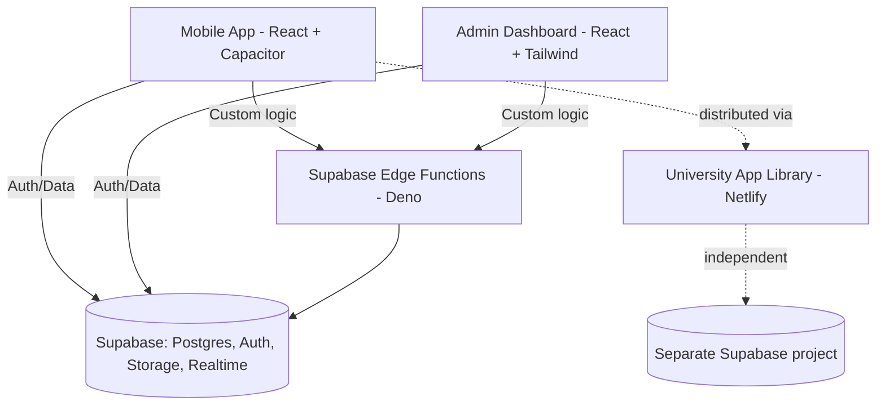

# ARCHITECTURE.md — CampusFind

## System Architecture

CampusFind = mobile app + admin dashboard, sharing one Supabase project. The University App Library is architecturally **separate** — own Supabase project, own management (university IT, not ISSC) — and only relates to CampusFind as its distribution point. Express.js has been fully replaced by Supabase Edge Functions (Part 11).

## Tech Stack

| Layer | Choice | Rationale |
|---|---|---|
| Frontend (app) | React 19.x + Tailwind CSS | Component-based UI, utility-first styling, fast iteration |
| Frontend (admin) | React 19.x + Tailwind CSS | Component-based UI, utility-first styling, fast iteration |
| Animation | Framer Motion (Motion) | Gesture-driven, physics-based motion beyond CSS-only capability |
| Backend (custom logic) | Supabase Edge Functions (Deno) | Replaced Express.js — serverless, co-located with Supabase |
| Cloud backend | Supabase (Postgres, Auth, Storage, Realtime) | Unified backend for DB, auth, sync, file storage |
| Mobile packaging | Capacitor (Ionic) | Wraps React app into native Android/iOS without separate codebase |
| Native plugins | @capacitor/share, @capacitor/clipboard | Share reports, copy links on Android |
| Hosting | Netlify | Web app + App Library landing page, git-linked deploy |
| Version control | Git + GitHub (fumio65/campusfind) | Collaboration, branching |

## Supabase Edge Functions (all deployed)
Base URL: https://muigquisnrhdbvnexyzu.supabase.co/functions/v1
All require `apikey` header with Supabase anon key. All return CORS headers, 204 for OPTIONS.

| Function | Routes |
|---|---|
| `reports` | GET /reports, POST /reports, PATCH /reports/:id, POST /reports/:id/resolve, POST /reports/:id/announce |
| `claims` | POST /claims, PATCH /claims/:id, POST /claims/:id/message, POST /claims/:id/dropoff |
| `tips` | POST /tips/notify, PATCH /tips/:id/credit |
| `dropoff` | POST /dropoff, GET /dropoff, PATCH /dropoff/:id/receive, PATCH /dropoff/:id/pickup |
| `accounts` | GET /accounts, POST /accounts/single, POST /accounts/bulk-import |
| `analytics` | GET /analytics |
| `notifications` | GET /notifications, PATCH /notifications/:id |
| `walkin` | POST /walkin |
| `proxy` | POST /proxy |
| `confirm` | POST /confirm |

## Key Design Patterns
- **Feature-based architecture** — organized by domain (auth, reports, claims, tips, analytics, dropoff), not technical layer.
- **Offline-first** — core read/draft actions work without connectivity; sync on reconnect. Cloud-dependent features (claims, messaging, notifications) require connectivity.
- **Status-driven data model** — every report has a single source-of-truth status field; analytics, history, and notifications all query off it. Avoids ambiguous "is this resolved?" logic.
- **All-or-nothing bulk validation** — CSV import validates the entire file before any DB writes; admin reviews/edits a preview before committing (no partial imports).
- **Deep link with graceful fallback** — share links open the app directly if installed, fall back to App Library page if not. No deferred deep linking (post-install resume) — flagged as future work.
- **Silent fetch** — all realtime/action-triggered fetchAll() calls use fetchAll(true) to skip loading state and preserve scroll position.
- **Scroll container** — AppShell main has overflow-y-auto; all scroll operations target document.querySelector('main'), not window.
- **Neutral drop-off marker** — stored as `ISSC_DROPOFF` in claim_messages, displayed context-aware per role in UI.

## Data Models (core entities)

**User**
- `student_id` (YY-NNNNN, unique)
- `enrollment_number` (6-10 digits, unique)
- `role` (student | admin)
- `trust_score` (int, default 100)
- `status` (active | deactivated)
- `force_password_change` (bool)

**Report**
- `type` (lost | found_walkin)
- `title`, `description`, `location`
- `photos[]` (max 3, optional)
- `status` (open | claimed | approved | resolved | rejected*)
  - *rejected loops back to open
  - found_walkin uses simplified open → resolved only
- `reporter_id` (User)
- `walkin_finder_ref` (string, admin-logged, found_walkin only)
- `resolved_via` (handoff | issc_dropoff | issc_walkin_pickup)

**Claim**
- `report_id`, `claimant_id`
- `photos[]` (max 3, mandatory)
- `status` (pending | approved | rejected)
- `message_thread_id` (capped at 10 messages)

**Tip**
- `report_id`, `user_id`
- `text` (no photo)
- `credited` (bool)
- `parent_tip_id` (nullable, for replies)
- `converted_to_claim_id` (nullable)
- max 25 per report

**TrustScoreEvent**
- `user_id`, `delta`, `reason`, `timestamp`

**DropoffRequest** (new in Part 11)
- `report_id`, `claim_id`, `claimant_id`, `reporter_id`
- `status` (pending | received | resolved)
- `drop_off_photo_path` (storage path, set when admin marks received)

## Report Status Lifecycle

- Reminder cadence: Approved status triggers reporter reminder at day 3, repeating until confirmed; admin can manually force-resolve if unresponsive.

## Trust Score Rules

| Event | Delta |
|---|---|
| Claim rejected | -5 |
| 3+ rejections in 30 days | -5 (additional) |
| No-show at handoff | -10 |
| Claim approved + handoff completed | +5 |
| Item returned via ISSC drop-off | +5 |
| Tip credited with helping recovery | +2 |

Visible to reporter at claim-review only. No automatic enforcement/restriction.

## API Structure (Supabase Edge Functions, REST)
- `POST /accounts/bulk-import` (CSV upload → validate → preview → confirm)
- `POST /accounts/single`
- `GET /reports` / `POST /reports` / `PATCH /reports/:id`
- `POST /reports/:id/resolve`
- `POST /reports/:id/announce`
- `POST /claims` / `PATCH /claims/:id` (approve/reject)
- `POST /claims/:id/message`
- `POST /tips/notify` / `PATCH /tips/:id/credit`
- `POST /dropoff` / `GET /dropoff` / `PATCH /dropoff/:id/receive` / `PATCH /dropoff/:id/pickup`
- `GET /analytics` (admin only, filterable)
- `GET /notifications` / `PATCH /notifications/:id`

## Storage Buckets
- `report-photos` — report photos, claim photos, resolve proof photos, drop-off received photos

## Future Enhancements (explicitly out of current scope)
- Load balancing beyond Supabase/Netlify defaults
- Dedicated caching layer beyond Netlify CDN
- Automated CI/CD pipeline with pre-deploy testing
- Deferred deep linking (auto-resume report after install)
- Offline support for cloud-dependent features
- App Library: search, ratings, version management (only CampusFind listed today)
